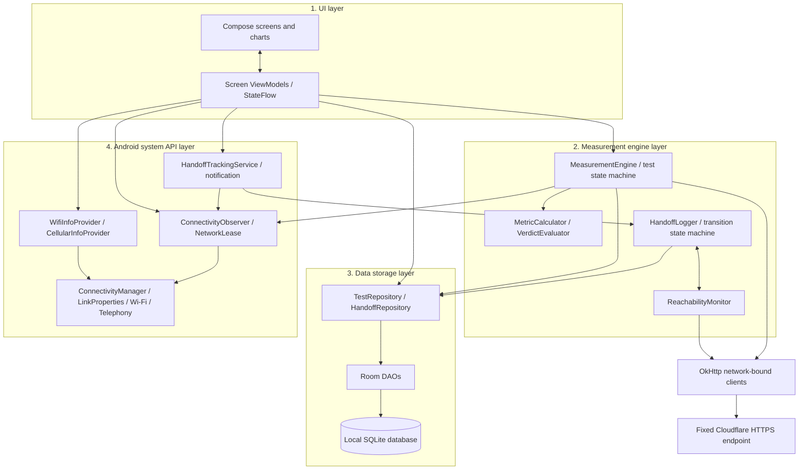

# NetShift implementation plan

CS 312 Mobile Computing | Planning baseline: **November 25, 2026, Asia/Manila** | Demo deadline assumed: **November 28, 2026**

**Status: implementation planning baseline.** Project initialization was authorized on November 25, 2026 for https://github.com/russcod3/NetShift. See README.md for the implemented initialization scope and remaining work. This document describes the complete planned application, not a claim that every feature is already implemented.

## 1. Delivery scope and engineering decisions

**MUST** means required for the final course demo, including a visible, safe fallback where Android withholds information. **OPTIONAL** means stretch work that starts only after the MUST acceptance checks pass. The first working demo checkpoint is deliberately smaller than final core completion.

| Priority | Deliverable / decision |
| --- | --- |
| MUST | Native Kotlin + Jetpack Compose, one `:app` module, Android Studio, four logical layers. Use coroutines and StateFlow; manual dependency injection through one application container. |
| MUST | Active default network, assigned IP addresses, Wi-Fi RSSI/band/link speed/SSID, and cellular carrier/radio type/signal level when accessible. Restricted or unsupported fields display **Unavailable** with a reason. |
| MUST | Twenty timed HTTPS probes, HTTP latency, adjacent-sample jitter, probe-loss percentage, and one capped download; every started test is recorded locally. |
| MUST | Explicit Wi-Fi or cellular selection, network-bound traffic, a mobile/metered-data warning, cancellation, a 29-second engine deadline, and no silent switch of transport within a result. |
| MUST | Results, Wi-Fi/cellular comparison, activity verdicts, locally named test locations, history list and charts, and handoff log. |
| MUST | User-started background tracking session with a foreground service, default-network callbacks, IP snapshots, and clearly qualified reconnection/interruption measurements. |
| MUST | Room storage only; no account, analytics, result upload, or application backend. HTTPS measurement requests still expose normal connection information to the test provider. |
| MUST | Simple Compose-native charts: paired bars using Compose layout primitives and a small Canvas history line chart. Exact values and accessible text accompany every chart. |
| OPTIONAL | GPS test-spot map and upload throughput. Neither appears in the core measurement flow or blocks submission. |

**Chart choice:** Compose-native drawing is the safer fit for these two small chart types and this deadline: no extra repository, View bridge, or chart-library migration. Keep history charts to 50 displayed points and omit zoom, pan, and animated transitions. MPAndroidChart remains a valid alternative if the team already has working code, but do not introduce it mid-sprint. Its current 4.x documentation describes a rewrite and a Compose module requiring compile SDK 37, which would expand this plan's toolchain scope. This is a scope-based recommendation, not a claim that Compose drawing replaces a general chart library. [MPAndroidChart maintainer documentation](https://github.com/PhilJay/MPAndroidChart/blob/master/README.md)

**Measurement terminology is part of the deliverable:** an ordinary Android app does not have a portable, unprivileged raw-ICMP socket solution. Some devices ship a usable `ping` executable; availability, options, permissions, and parsing vary. Use OkHttp HTTPS probes for reproducibility. Their failure rate is an **application probe-loss proxy**, not observed IP-packet loss: TCP can retransmit lost packets successfully. Label the UI **“Probe loss (%)”**, with help text explaining the distinction; use “packet loss proxy” in the report. Do not claim ICMP or UDP measurements.

**Accuracy is an evaluation target, not a guarantee:** a short, single-download test with an approximately 20 MB budget cannot promise results within 15% of every Speedtest/Fast.com result. Routes, remote servers, timing definitions, parallelism, and TCP startup differ. Measure and report the required comparison honestly; obtain the instructor's agreement on proxy terminology and comparability. The app must never multiply results by a calibration factor merely to match a reference.

## 2. Architecture — MUST



| Layer | Responsibilities and boundaries |
| --- | --- |
| UI | Rendering, navigation, permission launchers, mobile-data confirmation, selections, and chart descriptions. ViewModels expose immutable state; composables never open sockets or access DAOs directly. |
| Measurement engine | Test orchestration, deadlines/data budget, metric formulas, verdict rules, and handoff correlation. Pure metric and transition logic accepts plain snapshots and an injectable monotonic clock. OkHttp is an implementation dependency here, not another architectural layer. |
| Data storage | Persist start/final states, expose Room Flows, select comparable results, rename locations, and clear history. Serialize structured diagnostic fields consistently. No network or Android permission logic. |
| Android system APIs | Convert callbacks and device APIs into snapshots; acquire/release selected networks; own foreground-service lifecycle and notification. Guard OS versions and permission-sensitive calls. |

**Lifecycle and threading:** one application-scoped container owns Room, repositories, the shared connectivity observer, and the engine. Use a Mutex to permit one measurement at a time. Serialize callback events through a single consumer so transitions cannot race. Run network and database work off the main thread; callbacks enqueue events and return immediately. Collect UI Flows with `collectAsStateWithLifecycle`. A test survives rotation and screen navigation through the shared engine; backgrounding the entire app cancels an interactive test and saves its partial state. Background handoff tracking has its own explicit service lifetime.

Keep observer ownership reference-counted between visible UI and the tracking service. Register once per owner and unregister/release all callbacks, requests, jobs, response bodies, and network-specific pools when their owner ends. No WorkManager, Hilt, multi-module build, or continuous polling of signal APIs is needed for the core.

## 3. Project structure and class contracts — MUST

Use application ID and base package `edu.cs312.netshift`, subject only to the team's final naming choice. The tree describes future files; it does not create implementation files now.

```text
PLAN.md
settings.gradle.kts
build.gradle.kts
gradle/libs.versions.toml
gradle/wrapper/gradle-wrapper.properties
app/
  build.gradle.kts
  schemas/                         Room exported versioned schemas
  src/main/AndroidManifest.xml
  src/main/java/edu/cs312/netshift/
    NetShiftApplication.kt
    AppContainer.kt
    model/                         plain cross-layer data contracts
      NetworkSnapshot.kt           transport, handles, IPs, metadata, availability
      MeasurementState.kt          phase, progress, result ID, error/cancel reason
      ProbeSample.kt               attempt index, relative time, RTT or failure
      MeasurementConfig.kt         profile ID and immutable limits
    ui/
      MainActivity.kt
      navigation/NetShiftNavHost.kt
      live/LiveScreen.kt, LiveViewModel.kt
      test/TestScreen.kt, TestViewModel.kt
      results/ResultsScreen.kt, CompareScreen.kt, ResultsViewModel.kt
      history/HistoryScreen.kt, HistoryViewModel.kt
      handoff/HandoffLogScreen.kt, HandoffViewModel.kt
      components/MetricCard.kt, PairedMetricBars.kt, HistoryLineChart.kt
      permissions/PermissionCoordinator.kt
      theme/
    measurement/
      MeasurementEngine.kt
      BoundHttpClientFactory.kt
      ProbeRunner.kt
      DownloadRunner.kt
      MetricCalculator.kt
      VerdictEvaluator.kt
      HandoffLogger.kt
      HandoffStateMachine.kt
      ReachabilityMonitor.kt
      MonotonicClock.kt
    data/
      TestRepository.kt
      HandoffRepository.kt
      db/NetShiftDatabase.kt, RoomConverters.kt
      db/entity/TestResultEntity.kt, HandoffEventEntity.kt
      db/dao/TestResultDao.kt, HandoffEventDao.kt
    platform/
      ConnectivityObserver.kt
      NetworkLeaseProvider.kt
      WifiInfoProvider.kt
      CellularInfoProvider.kt
      IpAddressSelector.kt
      HandoffTrackingService.kt
      TrackingNotification.kt
  src/main/res/xml/                 backup / data extraction exclusions
  src/test/                        pure logic and fake HTTP tests
  src/androidTest/                 Room and minimal UI/device integration tests
docs/                              later: evaluation evidence and demo script
```

| Contract / class | Required behavior |
| --- | --- |
| `MeasurementEngine` | Start with selected transport and location name; expose StateFlow; cancel by reason; acquire and release a network lease; save one durable result ID per start. |
| `NetworkLeaseProvider` | Suspend while requesting a selected transport, produce its actual Network + callback snapshots, enforce acquisition timeout, and release in all exit paths. A lease is in-memory, never restored from a database handle. |
| `BoundHttpClientFactory` | Build isolated clients/pools for a particular Network and policy; bind DNS and sockets; return an observable cancellable Call path. |
| `ConnectivityObserver` | Expose the app's current default network from callback snapshots. Keep this separate from the network explicitly selected for a measurement. |
| `WifiInfoProvider`, `CellularInfoProvider` | Produce nullable values with `AVAILABLE`, `PERMISSION_DENIED`, `REDACTED`, `UNSUPPORTED`, or `NO_CONNECTION` reasons; preserve transport detection even if details are absent. |
| `HandoffLogger` / state machine | Consume ordered default-route snapshots; persist and complete transition rows; correlate optional heartbeat evidence without assuming callback time equals packet interruption. |
| `TestRepository` | Insert RUNNING row, finalize/update it, recover unfinished rows, observe history/detail, obtain comparison candidates, rename a location, and clear tests. |
| `HandoffRepository` | Insert/update transitions, observe newest first, close pending rows when a session ends, and clear events. |
| Screen ViewModels | Combine repository/observer state into UI state; no duplicate measurement engines or service instances. |

## 4. Room data model — MUST

Database: `netshift.db`, initial schema version **1**, `exportSchema=true`. IDs are generated UUID strings. Kotlin types below are exact; enum-like String values use constants and validation rather than ordinal storage. `Long` timestamps are UTC Unix milliseconds; display in device local time. All durations use a monotonic clock (`SystemClock.elapsedRealtimeNanos`), never wall-clock subtraction.

Room mapping: String → TEXT, Long/Int/Boolean → INTEGER, Double → REAL. Nullable fields mean unavailable/unmeasured; never encode missing latency as zero or an IP as `0.0.0.0`. Store JSON text with a schema version using Android's built-in JSON support; do not add a serialization plugin for two small payloads. Raw JSON is not queried by SQL.

### 4.1 `TestResultEntity` → `test_results`

| Field | Kotlin type | Meaning / initial value |
| --- | --- | --- |
| `id` | `String` | Primary key UUID. |
| `startedAtEpochMs` | `Long` | Start after confirmation; persisted before measurement traffic. |
| `finishedAtEpochMs` | `Long?` | Null while running. |
| `durationMs` | `Long?` | Confirmation-to-terminal elapsed duration, including acquisition. |
| `locationName` | `String` | Trimmed 1–60 characters; blank becomes `Unlabelled`. User label, not GPS. |
| `locationKey` | `String` | Name normalized by trimming, collapsing whitespace, and lowercase with `Locale.ROOT`; update with name on rename. |
| `status` | `String` | `RUNNING`, `COMPLETE`, `PARTIAL`, `FAILED`, `CANCELLED`, `ABORTED`. |
| `failureReason` | `String?` | Stable reason such as `NETWORK_UNAVAILABLE`, `NETWORK_CHANGED`, `ENDPOINT_ERROR`, `DEADLINE`, `PROCESS_ENDED`. |
| `requestedTransport` | `String` | `WIFI` or `CELLULAR`. |
| `measuredTransport` | `String?` | Actual selected network's transport; null if never acquired. |
| `networkHandle` | `Long?` | Diagnostic handle of the selected network; not a reusable identifier. |
| `startIpAddressesJson` | `String?` | Canonical sorted assigned IPv4/IPv6 address list; null if no snapshot. |
| `endIpAddressesJson` | `String?` | Last selected-network address list. |
| `ssid` | `String?` | Wi-Fi name if permitted; no BSSID/MAC collection. |
| `wifiRssiDbm` | `Int?` | Wi-Fi RSSI at test start. |
| `wifiFrequencyMhz` | `Int?` | Frequency used to derive 2.4/5/6 GHz band. |
| `wifiLinkSpeedMbps` | `Int?` | Negotiated Wi-Fi link speed, explicitly separate from measured download. |
| `cellularNetworkType` | `String?` | `LTE`, `NR_SA`, `LTE_NR_NSA_DISPLAY`, `OTHER`, or `UNKNOWN`. |
| `cellularSignalLevel` | `Int?` | OS signal level 0–4, or null if unavailable. Zero is valid weak/no signal. |
| `carrierName` | `String?` | Carrier/network operator display name. |
| `subscriptionId` | `Int?` | Selected active data subscription if available; local diagnostic only. |
| `metadataAvailabilityJson` | `String` | Per-field missing-data reasons, initially `{}`. |
| `isMetered` | `Boolean?` | Selected network's metering status. |
| `wasValidatedAtStart` | `Boolean?` | OS validation flag, independent of endpoint reachability. |
| `endpointBaseUrl` | `String` | `https://speed.cloudflare.com/__down`. |
| `serverAddress` | `String?` | Remote connection address from OkHttp, if known; no extra IP service. |
| `profileId` | `String` | `https20-v1`; changes whenever measurement definitions/limits change. |
| `probeCountPlanned` | `Int` | Always 20 for this profile. |
| `probeCountAttempted` | `Int` | Starts at 0; increments only when a probe is launched. |
| `probeCountSucceeded` | `Int` | Successful timed probes, excluding warm-up. |
| `probeCountFailed` | `Int` | Attempted minus succeeded; not unlaunched slots. |
| `probeSamplesJson` | `String` | Versioned records of index, relative start ms, elapsed ms, success, failure category, HTTP status; initially empty list. |
| `latencyMedianMs` | `Double?` | Median successful HTTPS probe elapsed time. |
| `jitterMs` | `Double?` | Mean absolute RTT difference for adjacent successful original slots. |
| `jitterPairCount` | `Int` | Number of valid adjacent pairs; starts at 0. |
| `probeLossPercent` | `Double?` | Proxy rate for completed 20-probe phase; null for incomplete/invalid phase. |
| `downloadBytes` | `Long` | Payload bytes actually read; starts at 0. |
| `downloadBodyDurationMs` | `Double?` | Body-read measurement interval. |
| `downloadWallDurationMs` | `Long?` | Whole download call duration for diagnostics. |
| `downloadMbps` | `Double?` | Decimal Mbps of application payload. |
| `downloadStopReason` | `String?` | `EOF`, `BYTE_LIMIT`, `TIME_LIMIT`, `NETWORK_LOST`, `IO_ERROR`, `HTTP_ERROR`, `USER_CANCEL`. |
| `measurementPayloadBytes` | `Long` | Warm-up + probe bodies + download bodies; starts at 0. |
| `qualityFlagsJson` | `String` | E.g. `SHORT_DOWNLOAD`, `SPARSE_PROBES`, `DEFAULT_ROUTE_CHANGED`, `ENDPOINT_ERROR`; initially empty list. |
| `verdictRulesVersion` | `Int` | 1. |
| `activityVerdictsJson` | `String` | Versioned per-activity status and limiting metric; initially empty list. |

Do not put upload or coordinates into schema v1 speculatively. OPTIONAL features add a reviewed migration and nullable fields later.

### 4.2 `HandoffEventEntity` → `handoff_events`

| Field | Kotlin type | Meaning / initial value |
| --- | --- | --- |
| `id` | `String` | Primary key UUID; reused when a pending transition completes. |
| `sessionId` | `String` | Tracking-session UUID, different after every explicit restart. |
| `kind` | `String` | `HANDOFF`, `DISCONNECT`, `RECONNECT`, `NETWORK_CHANGE`, `IP_CHANGE`, `TRACKING_STARTED`, `TRACKING_STOPPED`. |
| `status` | `String` | `PENDING`, `RECOVERED`, `UNVERIFIED`, `SUPERSEDED`, `SESSION_ENDED`. |
| `detectedAtEpochMs` | `Long` | First observed boundary: old-route loss or new default arrival. |
| `detectedElapsedMs` | `Long` | Same boundary on monotonic clock, meaningful within this session/boot. |
| `toAvailableAtEpochMs` | `Long?` | Arrival time of new default, if one appears. |
| `completedAtEpochMs` | `Long?` | Finalization/recovery/session-end timestamp. |
| `fromTransport` | `String` | `WIFI`, `CELLULAR`, `OTHER`, `VPN`, `NONE`, `UNKNOWN`. |
| `toTransport` | `String` | Same values; initially `NONE` for an open disconnect. |
| `fromNetworkHandle` | `Long?` | Cached old default handle. |
| `toNetworkHandle` | `Long?` | New default handle. |
| `fromIpAddressesJson` | `String?` | Last cached old address set. |
| `toIpAddressesJson` | `String?` | New callback address set, populated when available. |
| `fromPrimaryIp` | `String?` | Preferred assigned address for compact list display. |
| `toPrimaryIp` | `String?` | Preferred new assigned address. |
| `fromValidated` | `Boolean?` | Last cached old OS validation. |
| `toValidated` | `Boolean?` | New OS validation when known. |
| `routeGapMs` | `Long?` | Observed absence of any default network; zero only if callback sequence showed overlap. |
| `lastSuccessfulProbeElapsedMs` | `Long?` | Start time of last successful heartbeat before disruption. |
| `firstFailedProbeElapsedMs` | `Long?` | Start time of first failed heartbeat in the contiguous failure sequence. |
| `firstRecoveredProbeElapsedMs` | `Long?` | Completion time of first successful heartbeat on this event's new default. |
| `observedInterruptionMs` | `Long?` | Recovery completion minus first failed probe start, only when both exist. |
| `interruptionUpperBoundMs` | `Long?` | Recovery completion minus last successful probe start, if available. |
| `switchToReachableMs` | `Long?` | New-default arrival to first successful new-network heartbeat completion. |
| `heartbeatIntervalMs` | `Int?` | 1,000 while active; null for passive-only evidence. |
| `timingQuality` | `String` | `PROBE_BOUNDED`, `NO_FAILURE_OBSERVED`, `CALLBACK_ONLY`, `PAUSED`, `UNRECOVERED`, `SLEEP_GAP`. |
| `linkedTestId` | `String?` | Optional association with a simultaneously running test; no required foreign key. |
| `detailsJson` | `String` | Versioned failure reasons/session markers and redaction notes; initially `{}`. |

`TRACKING_STARTED`/`STOPPED` are lifecycle markers; IP/timing fields can be null. Use them to show recording gaps without adding a third core table. Never infer unobserved handoffs across sessions.

**Indexes and DAO behavior:** index tests by `startedAtEpochMs` and `(measuredTransport, locationKey, startedAtEpochMs)`; index events by `detectedAtEpochMs` and `(sessionId, detectedAtEpochMs)`. Use `id` for insert/update identity. DAOs provide suspend insert/finalize operations, test-by-ID Flow, filtered newest-first test Flow, newest-first event Flow, and an ascending latest-50 query for each history metric. Comparison candidates must satisfy section 8 eligibility. Rename updates both name and key atomically. Keep filtering/selection in repository queries; no pagination framework for a course-sized dataset.

Write the RUNNING test before issuing HTTP. Finalize in one transaction with metrics and verdicts. A single best-effort save in `finally` handles cancellation; database failures remain visible and retryable. On next launch mark lingering RUNNING tests `ABORTED/PROCESS_ENDED` and pending events from ended sessions `SESSION_ENDED`; do not resume traffic automatically. Never call `fallbackToDestructiveMigration` after collecting evaluation data. Disable cloud backup and exclude this database from device transfer where supported to keep records local.

## 5. Measurement design — MUST

### 5.1 Fixed server and protocol contract

Use **`https://speed.cloudflare.com/__down`** for both tiny probes and download, with only byte count and a unique request nonce changing. Probe URL: `...?bytes=1&netshiftNonce=<unique>`. Download URL: `...?bytes=18000000&netshiftNonce=<unique>`. There is no server account or backend to deploy. Cloudflare's own measurement engine documents this download endpoint and byte-count requests; its latency profile uses zero-byte requests. NetShift's one-byte choice makes body validation explicit. [Cloudflare's official measurement engine](https://github.com/cloudflare/speedtest/blob/main/README.md)

This public endpoint has no service guarantee for this project. **First implementation acceptance gate:** on each demo connection, verify HTTPS, status 200, one-byte response behavior, byte-count behavior, response encoding, caching, and whether a nonce is accepted. Do not run a full 18 MB download just to check availability before mobile consent. Use a 1,024-byte contract check. Nonce compatibility and rate-limit behavior must be verified; the provider may change its interface.

Use ordinary TLS validation, redirects disabled, automatic retry-on-connection-failure disabled, no disk cache, `Cache-Control: no-cache, no-store`, and `Accept-Encoding: identity`. Reject unexpected compressed content and redirects instead of timing a portal or expanding transferred data. Keep sequential probes on a reusable per-network pool. Do not force a new TLS handshake on every successful probe. An actual reconnect after failure is included in that probe's elapsed time and noted diagnostically.

Do not import the Cloudflare JavaScript library into Android: it has different timing/budget policies and result-reporting behavior. NetShift makes only direct GET measurement requests and never posts saved records. If the endpoint is blocked or changes, display server unavailable and save failure. OPTIONAL contingency: a university-controlled/static HTTPS host or minimal byte-serving Worker, after separately checking current hosting limits and deploying it before use; adopt exactly one endpoint and a new profile ID for all evaluation runs. No silent server rotation.

### 5.2 Network selection, ownership, and classification

1. Before starting, snapshot the currently default transport for the Live screen. The Test screen separately asks **Wi-Fi** or **Mobile data**, preselecting the current supported transport.
2. Show the estimated payload and consent warning for any cellular selection or other metered network. Only after confirmation start the 29-second clock and insert the RUNNING row. Cancelling the warning creates no measurement record or traffic.
3. Request a Network with `NET_CAPABILITY_INTERNET`, `NET_CAPABILITY_NOT_VPN`, and the chosen transport using `ConnectivityManager.requestNetwork`. Hold the request only for this test. An explicit request can activate cellular while Wi-Fi remains default; it cannot enable a user's disabled radio, grant a data subscription, or bypass an administrator policy. Cap acquisition at **3,000 ms**; record `NETWORK_UNAVAILABLE` if it fails. Provide a route to system settings for a manual retry. Do not toggle Wi-Fi or mobile data programmatically.
4. Wait for capabilities and LinkProperties from that request's callbacks. Reject portal, unsupported/VPN, transport mismatch, and unusable-network cases. OS VALIDATED is useful context; a successful HTTPS contract response is the endpoint reachability check. Do not wait indefinitely for a validation flag.
5. Create an OkHttp client whose sockets use `network.socketFactory` and whose DNS uses `network.getAllByName(host)`. This binds both lookup and traffic; pinning only sockets can resolve on the wrong connection. Use a fresh ConnectionPool per Network and never reuse a pool from an earlier test's different handle. Avoid process-wide `bindProcessToNetwork`, which would affect unrelated app traffic. The Network API explicitly supports network-bound DNS and socket creation. [Android Network reference](https://developer.android.com/reference/android/net/Network)
6. A device VPN or required HTTP proxy makes interpretation ambiguous. For the core, show an explicit unsupported configuration and let the user change it in Settings; do not silently bypass a VPN/proxy. Verify proxy/VPN detection on the demo devices.
7. Tag the result using the **acquired Network's capabilities**, not the enabled Wi-Fi switch, the global default at finish, the presence of a SIM, or TelephonyManager alone. Persist its handle and initial IP/metadata snapshot.
8. Keep the test on this handle. A default-route switch alone does not change the measurement transport if this selected network remains usable. Record that context flag. If the selected network is lost, changes transport, or changes assigned addresses during measurement, cancel its calls and save PARTIAL/NETWORK_CHANGED; never finish a mixed Wi-Fi/cellular speed result. A separate handoff event can still be logged.
9. In every exit path cancel active Calls, close bodies, release callbacks/request and pool resources, and resume any paused tracking heartbeats.

### 5.3 Timing and data budgets

All budgets below are limits, not mandatory waits. Successful phases proceed immediately except for the defined probe pacing.

| Stage | Maximum | Details |
| --- | --- | --- |
| Initial local save + network acquisition | 3.5 s | Acquisition itself ≤3.0 s; failure to establish the initial durable record stops before HTTP. |
| Warm-up / endpoint reachability | 2.0 s | One untimed 1-byte GET on the selected client; includes DNS/TCP/TLS. |
| Timed probes | 12.0 s | Twenty sequential attempts, one 600 ms slot per attempt. |
| Download | 10.0 s | One request, 18,000,000-byte requested object; stop on byte or time limit. |
| Normal finalization allowance | 1.0 s | Calculation, publish terminal state, and local update. |
| Scheduled total | **28.5 s** | Remaining 0.5 s reserved before 29 s watchdog. |

The **global 29,000 ms deadline overrides every stage**. Compute each remaining timeout from the same monotonic deadline. At expiry cancel HTTP and publish a terminal result without waiting for a blocked DNS worker or a slow database retry. Use asynchronous OkHttp calls with cancellation wired to `Call.cancel`; do not put blocking `execute()` on the UI thread. An OS DNS lookup may not stop immediately when cancelled; late callbacks must be ignored using the test ID/generation. Do not wait for its thread to return before showing the terminal state. The measured target is user-visible terminal test state within 30 seconds; disk-error retry can be shown separately as an unsaved-result state.

Payload policy: request **18,000,000 bytes** for download, plus at most 21 one-byte warm-up/probe responses. Count all read response bodies, including partial failed reads; reject oversized probe bodies. Hard global application-payload ceiling is **19,000,000 bytes** as defense against unexpected responses. No automatic retries or redirects and no upload. This leaves margin under about 20 MB, but TLS, DNS, HTTP headers, and TCP retransmissions are outside the payload counter: **a strict carrier-billed 20 MB guarantee is not possible at this layer**. Display “Up to about 20 MB, plus network overhead”; comparison runs require two tests and separate consent for the mobile one. Reference tools can consume much more data and require separate awareness during evaluation.

### 5.4 Probe algorithm and failures

The single warm-up must finish successfully within its 2 s budget. If it fails, save FAILED with its actual timeout/transport/endpoint reason and no headline latency, jitter, or loss; do not spend the remaining budget on an endpoint that has not passed the contract check. Warm-up time is not a timed-probe sample.

After a successful warm-up, perform **20 original slots** numbered 0–19:

1. Schedule each attempt at the phase start plus `index × 600 ms`, never overlap attempts. A fast response waits until the next slot; a timeout uses the slot. Set whole-call, connect, read, and write timeouts to at most **600 ms**, clipped to the phase/global deadline.
2. Immediately before enqueueing record monotonic `startNs`; after status 200 and exactly one body byte plus confirmed end-of-body record `endNs`. Elapsed RTT is `(endNs - startNs) / 1,000,000.0`. This is complete tiny-HTTPS-request response time, including client scheduling and any necessary reconnect, not ICMP latency or an inferred one-way delay.
3. Close each response. A timeout or transport IOException is a failed probe with null RTT and a recorded category. Do not replace failed RTTs with timeout values or zeros and do not retry a slot.
4. A TLS verification error, redirect, non-200 status, wrong body size, or unexpected encoding is an endpoint/configuration failure: stop the test, record the reason, and suppress the headline loss/verdict. Do not describe server throttling or a login page as measured packet loss.
5. On user cancellation, lost selected network, or deadline/scheduler overrun, keep actual attempts and samples. Unlaunched slots are `NOT_ATTEMPTED`, not failed packets. A complete probe phase requires 20 launched attempts with outcomes; incomplete phases have no headline loss percentage.

Derived metrics for a valid completed probe phase:

- **Latency:** median of successful RTTs; for an even count average the middle two sorted values. If zero successes, null. Keep raw order separately for jitter.
- **Jitter:** let `P` contain each original adjacent pair `(i-1, i)` where both attempts succeeded. `jitterMs = sum(abs(rtt[i] - rtt[i-1])) / size(P)`. If there is no pair, null. Do not sort RTTs before this calculation or bridge a missing slot. This is a defined HTTP RTT-variation statistic, not RTP jitter.
- **Probe loss proxy:** `100.0 × (20 - succeeded) / 20`. The sample resolution is **5 percentage points**. Zero observed failures does not establish that true loss is below 1%. Partial-attempt counts remain visible without extrapolation to 20.
- A completed phase with all 20 transport timeouts gives 100% probe loss, null latency/jitter, and no download attempt if reachability is absent. It is a failed/no-reachability result, not a zero-latency success.
- Fewer than 16 successful probes or fewer than 10 jitter pairs sets `SPARSE_PROBES`; show measured values but no positive activity verdict. These confidence cutoffs are project rules, versioned with the profile.

Worked fixture: original RTT slots `[10, 20, failed, 50, 30]` give median 25 ms, adjacent-pair jitter `(10 + 20) / 2 = 15 ms`, and 20% failed probes for this five-sample unit-test fixture. Production loss always uses a completed 20-attempt profile; three failures out of 20 yield 15%.

### 5.5 Download algorithm

After probes, stream the one fixed-size object without saving it to disk or retaining the full body:

1. Send the GET on the same selected network client, with overall call duration ≤10 s and remaining global budget; use connect timeout ≤2 s and read timeout ≤2 s to escape stalls. Pause tracking heartbeats for the entire network test so they do not contaminate unloaded metrics or consume its payload budget.
2. After validating response status/headers, take `bodyStartNs` immediately before the first body read. Read sequentially into a reused **64 KiB buffer**, accumulating actual payload bytes. End the interval after the last included read. Use the cancellation/deadline handler to close a blocked read.
3. Stop at expected end-of-body, 18,000,000 download bytes, the 10 s planned limit, or the global deadline. Cancel immediately on wrong transport/network, invalid headers, unexpected oversized content, or a genuine I/O failure. The server's announced length never substitutes for bytes actually received.
4. Compute `downloadMbps = receivedBytes × 8 / elapsedSeconds / 1,000,000`. Mbps uses decimal units. Store body duration separately from whole-call duration; do not subtract an invented server delay.
5. EOF/BYTE_LIMIT or a planned TIME_LIMIT with positive bytes and positive duration can produce a capped-download estimate. Distinguish intentional time-limit cancellation from an unexpected I/O error. A genuine I/O failure retains diagnostic bytes/rate but makes the result PARTIAL and ineligible for ordinary comparison.
6. If body duration is **under 1,000 ms**, set `SHORT_DOWNLOAD`; display the rate with limited-confidence text and withhold a positive verdict/comparison default. Zero bytes or nonpositive duration gives null rate. A slow, time-capped download can be valid; do not discard it solely because it failed to finish 18 MB.

This is **single-download application goodput**, not link speed, radio capacity, or multistream access-link saturation. Fast connections may exhaust 18 MB before a stable measurement window; the core shows that limitation instead of repeatedly downloading until the answer looks right.

State order: `IDLE → ACQUIRING → WARMING_UP → PROBING → DOWNLOADING → SAVING → COMPLETE/PARTIAL/FAILED/CANCELLED`. Store partial evidence for every started run. Only both valid measurement phases produce COMPLETE; valid planned time-capping can still be COMPLETE, with stop reason shown. Deadline before meaningful download completion is PARTIAL. Repeated Start taps cannot create concurrent runs.

## 6. Live status and IP interpretation — MUST

- Use the app's default-network callbacks for **connection type**. Display Wi-Fi, Cellular, Offline, VPN, or Other. `NET_CAPABILITY_INTERNET` does not itself establish working internet; show a distinct validated/captive-portal/unverified badge.
- Read assigned addresses from callback **LinkProperties**, for both IPv4 and IPv6. Filter loopback, multicast, unspecified, and link-local addresses; sort a canonical address set. Prefer usable IPv4 for compact display, otherwise global/usable IPv6; retain both families. These are interface addresses, potentially private/CGNAT-side, not guaranteed public internet addresses. Null means not supplied; do not reuse an old address as if it were current.
- On API 31+, obtain Wi-Fi transport info through a foreground-only callback; request `FLAG_INCLUDE_LOCATION_INFO` only when the required permission is granted. On API 26–30, use guarded `WifiManager.connectionInfo`. Use RSSI, frequency, and negotiated link speed; derive 2.4/5/6 GHz from frequency ranges and return Unknown outside recognized ranges. No Wi-Fi scan loop or BSSID collection. SSID can be redacted even when other fields work. [Wi-Fi information and redaction](https://developer.android.com/reference/android/net/wifi/WifiInfo), [location-sensitive callback flag](https://developer.android.com/reference/android/net/ConnectivityManager.NetworkCallback)
- Update visible Wi-Fi details on callbacks plus a low-frequency refresh, at most once every 2 seconds while the Live screen is visible if the device does not send RSSI updates reliably. Do not run that refresh in the background.
- For cellular, select the active data subscription on API 30+; use the default data subscription on older devices. Create the subscription-specific TelephonyManager when possible. Use `TelephonyCallback.SignalStrengthsListener` on API 31+ and guarded `PhoneStateListener` on API 26–30; unregister on stop. Use the OS signal level 0–4. Carrier name is a display string, not subscriber identity. [TelephonyManager](https://developer.android.com/reference/android/telephony/TelephonyManager), [signal callback](https://developer.android.com/reference/android/telephony/TelephonyCallback.SignalStrengthsListener)
- Use the data network type for LTE/NR. Where available, TelephonyDisplayInfo can report an NSA 5G display override while the underlying type is LTE; label that distinction instead of claiming confirmed standalone NR. If display info or permissions are absent, show LTE/5G status unavailable as appropriate. No cell-tower identity, IMEI, IMSI, phone number, or privileged telephony access. [Display-info callback](https://developer.android.com/reference/android/telephony/TelephonyCallback.DisplayInfoListener)

SSID visibility, SIM attribution on dual-SIM devices, OEM signal callback frequency, 5G NSA presentation, and background process behavior require a real-device check. Signal strength is a context indicator, not a substitute for measured internet performance.

## 7. Handoff tracking — MUST

### 7.1 Default-route callback and transition rules

Use **`registerDefaultNetworkCallback`** for the user-visible Wi-Fi ↔ cellular handoff log. A general `registerNetworkCallback` can announce several networks simultaneously and is not sufficient to identify a default-route switch. Also, a measurement request for cellular while Wi-Fi stays default is not itself a handoff.

Consume `onAvailable`, `onCapabilitiesChanged`, `onLinkPropertiesChanged`, and `onLost`. Wait for capability/address callbacks after availability and cache immutable snapshots per handle. Do not synchronously ask ConnectivityManager for capabilities/LinkProperties inside `onAvailable`; that can race the callback stream. For a default callback, `onLost` means loss of default status, not necessarily destruction of the physical network. [Android network-state callback guidance](https://developer.android.com/develop/connectivity/network-ops/reading-network-state)

Transition state machine:

1. First complete default snapshot establishes a baseline and a tracking-start marker; it is not a handoff from nowhere.
2. A new default handle with a known transport closes a direct transition from the last default. Wi-Fi ↔ cellular becomes HANDOFF. Same-transport handle replacement becomes NETWORK_CHANGE; LTE ↔ 5G within one cellular connection is not a Wi-Fi/cellular handoff.
3. If the current handle is lost before a replacement is observed, immediately persist one PENDING DISCONNECT row with cached old transport/IP and `toTransport=NONE`. When a new default appears, update **that row**, becoming HANDOFF for a cross-transport switch, RECONNECT for same-transport restoration, or NETWORK_CHANGE for another supported change. Keep the actual offline interval even if it lasts many seconds.
4. If no new default arrives before tracking stops, finalize as DISCONNECT/SESSION_ENDED with unknown recovery time. Do not fabricate a new IP or successful reconnection. A later session starts a fresh baseline.
5. For a direct replacement where availability arrives before old loss, route gap is zero **as observed by callbacks**. A delayed `onLost(oldHandle)` must not erase the newer default. Match callbacks by handle and generation, not just arrival order.
6. New IPs may arrive after the switch row is inserted. Fill the new snapshot when its LinkProperties arrives; after 3 s keep missing values explicitly unavailable. A later correction can update the same event rather than make another handoff.
7. Address-set changes on the same default handle create IP_CHANGE events. Compare canonical sets to avoid duplicate events from callback repeats or ordering changes. IPv6 address rotation can happen without transport handoff.
8. Do not debounce away rapid real Wi-Fi → cellular → Wi-Fi flaps. Deduplicate repeated identical state; if a new switch supersedes an unverified recovery, preserve the prior event with SUPERSEDED timing status and begin the next generation.

The app demonstrates movement between interfaces, changed assigned IPs, routing, and interruption of application communication. **It does not implement classic Mobile IP**, home agents, care-of-address registration, or transparent session continuity. An IP staying the same does not disprove a handoff; a changed IP alone does not prove one.

### 7.2 Background execution and tradeoffs

Use a user-started **`HandoffTrackingService` foreground service** with Start/Stop controls, a persistent low-importance notification, and a notification Stop action. Start only while an Activity is visible and call `startForeground` promptly within the platform startup window. Use `START_NOT_STICKY`; no boot receiver or automatic background restart. Default tracking session length: **10 minutes**, visible countdown, explicit restart for another session.

For API 34+, choose **`specialUse`** with `FOREGROUND_SERVICE_SPECIAL_USE` and a manifest subtype explaining “User-started network handoff diagnostics with connectivity callbacks and local event logging.” This is the proposed fit for this sideloaded course diagnostic tool; verify actual startup on the demo devices. Android requires a declared foreground-service type and documents special-use explanations/review. Play distribution would require a separate policy review; this plan assumes a classroom APK. [Foreground-service types](https://developer.android.com/develop/background-work/services/fgs/service-types)

Do not label indefinite passive monitoring `dataSync`: it does not describe the primary operation and Android 15+ also imposes a six-hour aggregate timeout on that type. A visible-Activity-only observer would be simpler but would not satisfy background tracking. WorkManager is not a continuous, low-latency callback host. A foreground service improves process priority but does not guarantee survival after force-stop, OEM termination, or all deep-sleep scenarios. [Android 15 service restrictions](https://developer.android.com/about/versions/15/behavior-changes-15)

Background tracking uses transport and LinkProperties only. Stop the location-sensitive Wi-Fi detail callback when UI is not visible; background events can legitimately lack SSID/signal details. A `specialUse` service does not grant background location access. No background location permission is required by this core design.

### 7.3 Reconnection and interruption measurements

Keep **two distinct timing measurements** and explain them in the log detail:

**A. Observed route gap:** when old-default `onLost` precedes new-default `onAvailable`, `routeGapMs = newAvailableElapsedMs - oldLostElapsedMs`. If callback sequence shows overlap, zero means no route gap was observed. It does not establish zero packet interruption. No recovered default means null/open-ended gap until recovery or session end.

**B. HTTP reachability evidence:** during a tracking session, make one tiny GET to the same fixed endpoint every **1,000 ms**, call timeout **600 ms**, never overlap. Bind each call to the default Network snapshot at its launch; use a new client/pool when that handle changes. No available default is a failed scheduled reachability attempt without issuing traffic. Keep only the rolling evidence needed for the current event; save timestamps with the event.

- `switchToReachableMs = first new-network success completion - new-default availability`.
- If a contiguous failure run brackets the switch, `observedInterruptionMs = first new-network success completion - first failed attempt start`.
- With a prior successful probe, `interruptionUpperBoundMs = first recovered completion - last successful attempt start`. This includes sampling and probe duration; call it an estimate/bound, not precise physical downtime.
- If all sampled probes succeed, store `NO_FAILURE_OBSERVED`, not an invented 0 ms interruption. The detail may say “No outage observed at 1 s sampling”; display the route gap separately.
- No successful recovery, a provider error, or paused heartbeats yields null application interruption with the corresponding timing-quality reason. Callback events still save.
- Pause/cancel heartbeats during every full measurement, keep callbacks active, and flag affected timing `PAUSED`. Do not borrow probe timestamps from a different network or conflate the 20-test-probe stream with the heartbeat stream.
- Foreground-service execution does not guarantee 1 s wakeups in Doze. Detect scheduling gaps greater than 2.5 s, store `SLEEP_GAP`, and suppress precise interruption claims for that interval. No continuous wake lock for this short demo; test screen-off operation and document the observed limit.

The tracking Start screen discloses background operation and possible mobile traffic. Heartbeats have a separate cap of **600 attempts / 10 minutes**, 1-byte expected bodies, and no automatic retries; stop active probes at session end or malformed endpoint response. Protocol overhead dominates their tiny body size, so do not advertise a strict carrier-byte cap. Passive callback logging can continue only for the remainder of that explicit session if active probes are disabled by an error, clearly marked CALLBACK_ONLY.

## 8. Verdicts, comparison, screens, and navigation — MUST

### 8.1 Activity thresholds

These are **versioned classroom heuristics**, not provider service guarantees. All conditions in an activity row must pass. HTTP RTT/probe loss are proxies, and upload is unmeasured. Do not claim verified end-to-end video-call or game quality.

| Activity | Download minimum | Median HTTP RTT maximum | HTTP jitter maximum | Observed probe loss maximum |
| --- | --- | --- | --- | --- |
| Video call | 3 Mbps | 150 ms | 30 ms | 0% observed (0/20) |
| HD streaming | 5 Mbps | 250 ms | 50 ms | 5% observed (≤1/20) |
| Browsing | 1 Mbps | 500 ms | 100 ms | 5% observed (≤1/20) |
| Online gaming | 1 Mbps | 80 ms | 20 ms | 0% observed (0/20) |

Threshold comparisons include the boundary, e.g. RTT 150 ms passes a 150 ms maximum. For each activity return `LIKELY_SUITABLE`, `MAY_STRUGGLE`, or `INSUFFICIENT_DATA`, plus the limiting metric. Insufficient/missing metrics, a partial/failed run, sparse probes, or a short download prevent a positive verdict. For fully valid runs, any failing threshold gives MAY_STRUGGLE; passing every threshold gives LIKELY_SUITABLE. Round only for presentation, not before deciding.

Examples: “Likely suitable for HD streaming on this download check.” “Video calls may struggle: response times varied by 45 ms.” Always qualify two-way activities with **“Upload not tested.”** Help text explains that 0/20 observed failures cannot certify less than 1% real packet loss. Keep the threshold table in a pure rules object with `verdictRulesVersion=1` persisted alongside outputs.

### 8.2 Comparison eligibility and charts

Default Compare pairs the most recent eligible Wi-Fi and cellular tests with the **same normalized location label and profile ID**, preferably within 15 minutes, on the same device. If no such pair exists, ask for the missing run; do not silently compare different locations. Allow manual history selection, showing time/location differences visibly. Different measurement profiles cannot be overlaid as if equivalent.

Automatic comparison eligibility means COMPLETE, 20 valid probe outcomes, adequate successful/pair counts, measured download body interval ≥1 s, no selected-network change, and no endpoint/IO error. A valid planned time-limited download is eligible and labeled capped. Keep ineligible rows in history and allow details, but exclude them from automatic comparisons and aggregations. Manual comparison may include a COMPLETE short-download run with a prominent limited-confidence label; this preserves a useful side-by-side view on fast connections without treating it as an accuracy pass. Partial/mixed-network runs remain detail-only.

Show four **separate paired charts**, one each for latency, jitter, probe loss, and download. Each chart has its own labeled unit and common zero-based scale within that metric; do not combine Mbps and milliseconds on one axis. Indicate lower is better for the first three and higher is better for download. Use stable Wi-Fi/cellular colors plus text labels, exact values, timestamps, and accessible descriptions. Null data is a gap/Unavailable, never a zero-height value. When values are equal or zero, retain readable labels and a nonzero axis range.

History offers a metric selector and chronological line chart of the latest 50 eligible points, with separately labeled transports and a list of the underlying values. Preserve time gaps, avoid smoothing, and do not imply missing readings were measured. No complex gesture handling in the core.

### 8.3 Navigation and screen behavior

Use four top-level destinations: **Live, Test, History, Handoffs**. Results and Compare are secondary destinations. Pass result UUIDs as route arguments; load data from Room rather than passing large result objects. Simple string routes avoid a navigation-serialization plugin.

| Screen | Core content and actions |
| --- | --- |
| Live status | Current default transport, internet-state badge, assigned IPs, available Wi-Fi/cellular metadata, per-field fallback reasons, and permission detail action. Show when a selected test network differs from default. |
| Test | Wi-Fi/Mobile selector, location label, data/time limits, Start, phase/probe progress, Cancel, mobile/metered confirmation, and actionable offline/portal/server errors. No upload stage. |
| Results | Persisted test metrics, probe count and definitions, goodput confidence/cap flags, qualified activity verdicts, network/IP snapshot, timestamp/location, and Compare/Test again actions. Failed/partial attempts have an honest detail view. |
| Compare | Eligible Wi-Fi/cellular pair selectors, four paired metric charts, exact numeric values, and same-location/time warnings. |
| History | Local newest-first test list, location/transport filter, status indicators, metric/time chart, open result, rename location, and explicitly confirmed clear-history action. |
| Handoff log | Tracking Start/Stop and countdown, background status, newest-first events with before/after transport/IP, route gap and application interruption quality, and detail explanation. Session boundaries stay visible. |

Back from Results returns to Test/History as appropriate. Rotation preserves selected result and test progress. Permission denial never blocks history/results, basic transport detection, or network testing. Accessibility includes TalkBack descriptions, units, font scaling, sufficient contrast, and no color-only verdicts.

## 9. Permissions, manifest, and graceful fallbacks — MUST

| Manifest permission / entry | Use and runtime handling |
| --- | --- |
| `android.permission.INTERNET` | Normal permission for HTTPS; no runtime dialog. |
| `android.permission.ACCESS_NETWORK_STATE` | Normal permission for callbacks/capabilities. |
| `android.permission.CHANGE_NETWORK_STATE` | Normal permission for explicit `requestNetwork` acquisition; not radio toggling. |
| `android.permission.ACCESS_WIFI_STATE` | Normal permission for Wi-Fi information. |
| `android.permission.ACCESS_COARSE_LOCATION` | Declare with FINE; request together on Android 12+ when enabling SSID details. |
| `android.permission.ACCESS_FINE_LOCATION` | Runtime, optional to using the core app but required for location-sensitive SSID access. Keep declared beyond API 32 because the chosen SSID path can still require it. |
| `android.permission.READ_BASIC_PHONE_STATE` | Normal permission on API 33+ for supported basic phone/radio information; older OS ignores this declaration. |
| `android.permission.READ_PHONE_STATE` | Runtime when the cellular-detail API path requires it, particularly older OS/API combinations. Request in context, not at first launch. |
| `android.permission.FOREGROUND_SERVICE` | Normal permission for the tracking service on applicable versions. |
| `android.permission.FOREGROUND_SERVICE_SPECIAL_USE` | Normal type permission for API 34+ special-use tracking service. |
| `android.permission.POST_NOTIFICATIONS` | Runtime on API 33+, requested when the user first starts tracking. Denial does not technically prohibit an FGS. |
| Main activity | `android:exported=true`, MAIN/LAUNCHER intent filter. |
| Tracking service | `android:exported=false`, `android:foregroundServiceType="specialUse"`, subtype property below. Use the special-use start type on API 34+; guarded older start call otherwise. |
| Application | `android:usesCleartextTraffic=false`, `android:allowBackup=false`, explicit database exclusions in legacy backup and API 31+ data-extraction rules. No production trust-all TLS/network-security bypass. |
| Hardware declarations | Wi-Fi and telephony features with `required=false`; app remains usable on Wi-Fi-only devices and handles absent hardware. |

Short manifest illustration for the service type choice only:

```xml
<service android:name=".platform.HandoffTrackingService"
    android:exported="false" android:foregroundServiceType="specialUse">
    <property android:name="android.app.PROPERTY_SPECIAL_USE_FGS_SUBTYPE"
        android:value="User-started network handoff diagnostics and local logging" />
</service>
```

The baseline reads connected Wi-Fi information; it does not discover peers, start hotspots, or configure networks. **Do not automatically add `NEARBY_WIFI_DEVICES` just because the OS is Android 13+.** Add/request it only if an adopted Wi-Fi API explicitly requires it. It does not universally replace fine-location access for SSID-related data. Check the specific call's permission contract and actual device redaction. No `ACCESS_BACKGROUND_LOCATION`, Wi-Fi scan permissions beyond the chosen read path, privileged phone permission, external-storage permission, or GPS request in the core. [Android Wi-Fi permission guidance](https://developer.android.com/develop/connectivity/wifi/wifi-permissions)

Runtime flow:

1. Launch directly into basic status; no batch of unrelated permission dialogs.
2. “Enable Wi-Fi details” explains SSID access. Request COARSE + FINE as applicable; if only approximate location is granted, keep sensitive fields unavailable. Location services may also need to be enabled. Offer Settings as a user action, never force it.
3. “Enable cellular details” requests phone-state access only for fields/listeners that need it. Continue to show any safe basic carrier/radio/signal fields already available if permission is denied. Feature-check hardware and subscriptions first.
4. “Start tracking” explains duration, background notification, and small possible mobile-data probes; request notifications on API 33+. Even with denial, the service must supply its required notification, and Android exposes its FGS notice in the system task manager rather than the normal drawer. Keep in-app Stop available when foregrounded and explain where the system stop control appears. [Android notification permission behavior](https://developer.android.com/develop/ui/compose/notifications/notification-permission)
5. Re-check permissions on every protected access and after return from Settings; catch `SecurityException`/unsupported API paths even after an earlier grant. If permanently denied, show an optional app-settings action and do not repeatedly prompt. Revocation never crashes the observer, test, or history.
6. Normalize unknown SSID constants, invalid RSSI/link-speed sentinels, no SIM, unsupported radio types, and redacted fields to nullable values with explanations. Drop stale live metadata after disconnect.

The service's basic transport/IP logging must work without location or phone access. Denied optional detail permissions do not invalidate correctly collected measurements.

## 10. Build baseline and dependencies — MUST

Choose a conservative **pinned build baseline**, rather than upgrading to the newest 2026 releases during a three-day implementation. This is a recommended compatible starting set, not a claim that a build has been run in this empty workspace. Dependency resolution and the first clean build are implementation gate C1.

| Tool / setting | Recommended version / value |
| --- | --- |
| Android Studio | Installed stable release that supports AGP 8.9; Meerkat 2024.3.1 is the matching baseline. |
| JDK / Java and Kotlin JVM target | **17**; point Gradle at JDK 17 explicitly. |
| AGP plugin `com.android.application` | **8.9.2** (`com.android.tools.build:gradle:8.9.2`). |
| Gradle wrapper | **8.11.1**. |
| Kotlin plugins | `org.jetbrains.kotlin.android` **2.1.20** and `org.jetbrains.kotlin.plugin.compose` **2.1.20**. |
| KSP plugin | `com.google.devtools.ksp` **2.1.20-1.0.32**, KSP2 enabled. |
| SDKs | `minSdk=26`, `compileSdk=35`, `targetSdk=35`, SDK Build Tools 35.0.0. |
| Build conventions | Kotlin DSL, AndroidX, Compose build feature enabled, one app module, no native code. |

AGP 8.9's official compatibility table specifies API 35 support, Gradle 8.11.1, and JDK 17. Use the Compose compiler plugin matching Kotlin for Kotlin 2.x. The KSP release is explicitly paired with Kotlin 2.1.20. [AGP compatibility](https://developer.android.com/build/releases/agp-8-9-0-release-notes), [Compose compiler setup](https://developer.android.com/develop/ui/compose/setup-compose-dependencies-and-compiler), [KSP release](https://github.com/google/ksp/releases/tag/2.1.20-1.0.32)

This assumes direct classroom APK installation. A Play Store submission or a requirement to target a newer SDK changes scope and must be checked before changing this baseline. Running on a newer Android version is distinct from compiling against its newest APIs; use the defined guards and test the actual demo OS.

| Configuration | Gradle coordinate | Version / purpose |
| --- | --- | --- |
| `implementation(platform(...))` and `androidTestImplementation(platform(...))` | `androidx.compose:compose-bom` | **2025.04.01**; one BOM for both. |
| `implementation` | `androidx.compose.ui:ui` | BOM; Compose UI. |
| `implementation` | `androidx.compose.foundation:foundation` | BOM; layout/drawing. |
| `implementation` | `androidx.compose.material3:material3` | BOM; UI controls/theme. |
| `implementation` | `androidx.compose.ui:ui-tooling-preview` | BOM; previews. |
| `debugImplementation` | `androidx.compose.ui:ui-tooling` | BOM; preview tooling only. |
| `implementation` | `androidx.core:core-ktx` | **1.15.0**. |
| `implementation` | `androidx.activity:activity-compose` | **1.10.1**. |
| `implementation` | `androidx.lifecycle:lifecycle-runtime-compose` | **2.9.0**; lifecycle-aware collection. |
| `implementation` | `androidx.lifecycle:lifecycle-viewmodel-compose` | **2.9.0**; ViewModels. |
| `implementation` | `androidx.lifecycle:lifecycle-viewmodel-ktx` | **2.9.0**; coroutine scope helpers. |
| `implementation` | `androidx.navigation:navigation-compose` | **2.9.0**; simple string routes. |
| `implementation` | `org.jetbrains.kotlinx:kotlinx-coroutines-android` | **1.10.2**. |
| `implementation` | `com.squareup.okhttp3:okhttp` | **4.12.0**; familiar pinned API, no logging interceptor in production. |
| `implementation` | `androidx.room:room-runtime` | **2.7.2**. |
| `implementation` | `androidx.room:room-ktx` | **2.7.2**; Flow/suspend integration. |
| `ksp` | `androidx.room:room-compiler` | **2.7.2**, same version as runtime. |
| `testImplementation` | `junit:junit` | **4.13.2**. |
| `testImplementation` | `org.jetbrains.kotlinx:kotlinx-coroutines-test` | **1.10.2**. |
| `testImplementation` | `com.squareup.okhttp3:mockwebserver` | **4.12.0**; injected local HTTP behavior in tests only. |
| `androidTestImplementation` | `androidx.test.ext:junit` | **1.2.1**. |
| `androidTestImplementation` | `androidx.test:runner` | **1.6.2**; runner `androidx.test.runner.AndroidJUnitRunner`. |
| `androidTestImplementation` | `androidx.room:room-testing` | **2.7.2**. |
| `androidTestImplementation` | `androidx.compose.ui:ui-test-junit4` | BOM; small UI smoke suite. |
| `debugImplementation` | `androidx.compose.ui:ui-test-manifest` | BOM; Compose test host. |

Repositories: `google()` and `mavenCentral()` for application libraries; `google()`, `mavenCentral()`, and `gradlePluginPortal()` for plugins. Compose-native charts add no dependency and no JitPack. Do not use dynamic `+` versions, alpha/beta artifacts, the legacy Compose compiler extension alongside the new plugin, or KAPT alongside KSP. Configure the KSP Room schema output to `app/schemas` and commit generated schema v1 after implementation. Keep a version catalog and record the resolved dependency graph after the first green build. The BOM manages Compose libraries, not Activity, Navigation, Room, or the compiler. [Compose BOM mapping](https://developer.android.com/develop/ui/compose/bom/bom-mapping), [Room versions and setup](https://developer.android.com/jetpack/androidx/releases/room), [Navigation releases](https://developer.android.com/jetpack/androidx/releases/navigation)

The initialization build gate on Windows is `gradlew.bat :app:assembleDebug :app:testDebugUnitTest :app:lintDebug :app:assembleDebugAndroidTest`, followed by `:app:connectedDebugAndroidTest` when a device is available. Resolve actual dependency/metadata conflicts at that gate and update pins as a coherent set; do not waive lint or silently change SDK levels. See README.md and the initialization pull request for actual validation results; full measurement acceptance remains a later milestone.

## 11. Team plan and schedule

Role ownership: **Ronjae** owns Android integration, platform adapters, foreground service, and merges; **Russell** owns measurement/network clients, formulas, Room/repositories, and evaluation calculations; **Ivan** owns screens/charts, manual testing, participant sessions, and documentation. Share DTO/DAO contracts first. Use small feature branches, with Ronjae integrating at least twice daily; avoid all three editing the same navigation/build files. Each work item below is intended as a roughly 1–3 hour slice unless noted.

### 11.1 Requested original phase schedule — MUST baseline, not completion claims

Dates before November 25 are historical planning windows. Audit any existing team work against the acceptance criteria; do not assume those phases happened.

| Window / ID | Owner | Small ordered task | Acceptance criterion |
| --- | --- | --- | --- |
| Nov 6–9 / P1.1 | Ronjae | Create single-module project and freeze toolchain. | Debug APK builds and opens on one real phone. |
| Nov 6–9 / P1.2 | Ivan | Draft six screen states, navigation, empty/error/permission states. | Team can walk through Wi-Fi test → result → mobile test → compare on sketches. |
| Nov 6–9 / P1.3 | Russell | Freeze DTOs, metric definitions, payload/time profile, endpoint contract. | Worked jitter/loss fixtures agreed; tiny HTTPS contract check passes on Wi-Fi and cellular. |
| Nov 6–9 / P1.4 | Ronjae | Add minimal default-network observer. | Live transport and IP change on a real switch; no polling/crash. |
| Nov 10–14 / P2.1 | Ronjae | Add selected-network lease and per-call binding integration. | Cellular call can use cellular while default remains Wi-Fi; unavailable route fails promptly. |
| Nov 10–14 / P2.2 | Russell | Implement warm-up + 20-probe runner and pure calculator. | Exactly 20 outcomes on a normal run; timeout fixture respects phase budget; formula tests pass. |
| Nov 10–14 / P2.3 | Russell | Add capped streaming download and cancellation. | Bytes/time caps verified; buffer remains bounded; units match known-rate fixtures. |
| Nov 10–14 / P2.4 | Ivan | Wire Test and basic Results UI. | Start/phase/Cancel/mobile warning work without duplicate runs. |
| Nov 10–14 / P2.5 | Ronjae | Add Wi-Fi/cellular info adapters and detail permissions. | Grant/deny/location-off/no-SIM cases give values or explicit fallbacks. |
| Nov 15–19 / P3.1 | Russell | Add Room entities/DAOs, start/finalize save, and recovery. | Success/failure/cancel survive relaunch; unfinished run becomes ABORTED. |
| Nov 15–19 / P3.2 | Russell | Add versioned verdict evaluator. | Boundary, null, sparse-probe, and short-download fixtures pass. |
| Nov 15–19 / P3.3 | Ivan | Add History list, result detail, location naming, and paired charts. | Same-location Wi-Fi/cellular pair displays four correctly labeled metric charts. |
| Nov 15–19 / P3.4 | Ronjae | Implement ordered handoff state machine and IP snapshots. | Direct switch, offline-gap switch, duplicate callback, and same-handle IP change recorded correctly. |
| Nov 20–23 / P4.1 | Ronjae | Add explicit tracking foreground service and stop notification. | Tracking continues after Home; Stop ends callbacks and service; background permission fallback works. |
| Nov 20–23 / P4.2 | Russell | Add bounded reachability timing and pause coordination. | Route gap differs from sampled interruption; no heartbeat overlaps a full test. |
| Nov 20–23 / P4.3 | Ivan | Add Handoff log details and History metric chart. | Users can read before/after IPs, timing qualifiers, and historical values. |
| Nov 20–23 / P4.4 | Ivan + Russell | Prepare real-device checklist, accuracy worksheet, and SUS script. | Each success target has a fixed denominator, procedure, owner, and evidence location. |
| Nov 24–28 / P5.1 | Ronjae | Audit gaps, merge only missing core, test service on demo devices. | All six screen flows work in one installed build. |
| Nov 24–28 / P5.2 | Russell | Run controlled metrics/time/cap checks and reference pairs. | Raw results and calculations retained; discrepancies explained, never rescaled. |
| Nov 24–28 / P5.3 | Ivan + Ronjae | Run 20 ground-truth transport switches. | ≥18/20 matched detections; extras and timing limitations reported. |
| Nov 24–28 / P5.4 | Ivan | Test chart comprehension and standard SUS with 10 non-team students. | Comprehension target and mean SUS target assessed separately with anonymized responses. |
| Nov 24–28 / P5.5 | All, Ronjae release owner | Fix blocking issues, freeze APK, rehearse and finish course report. | Clean build/tests, repeatable demo, saved evidence, known limitations, and backup APK ready by Nov 28. |
| After all core gates / P5.S | Team only if time remains | OPTIONAL map or upload, choose at most one. | No regression of cap/time/privacy requirements; otherwise omit from submitted build. |

### 11.2 Compressed catch-up order from November 25 — MUST

Assume roughly **three focused 6–8 hour workdays plus a short November 28 release window**, not weeks of new work. The implementation should fit by dropping stretch work and polish, not by quietly reclassifying core background tracking as optional. If actual available hours are lower, bring the risk to the team immediately.

| Order / checkpoint | Ronjae | Russell | Ivan | Demonstrable acceptance |
| --- | --- | --- | --- | --- |
| C1 — Nov 25, first 1–2 h | Project/toolchain; minimal Activity; callback skeleton. | Shared DTOs/profile, Room start/finalize skeleton; tiny endpoint check. | Navigation/empty states and exact result labels. | APK opens; blank history; current transport/IP; dependency resolution works. |
| C2 — Nov 25, next 3–4 h | Bind the current supported Network, cancellation/lifecycle path. | Warm-up, 20 probes, download cap, formulas, and persistence. | Minimal Test → Results → History using numeric cards. | **First working demo:** one Wi-Fi test finishes within budget and survives relaunch. This is an intermediate checkpoint, not final core completion. |
| C3 — Nov 26 morning | Complete explicit Wi-Fi/cellular request path and metadata fallbacks. | Verdict logic, comparison eligibility, pure tests, failure/time-cap checks. | Four paired charts, location labels, history metric chart. | Wi-Fi then cellular produce valid separately tagged results and a readable comparison; denied details still allow tests. |
| C4 — Nov 26 afternoon | Default transition/IP logger, special-use FGS, Start/Stop/session boundaries. | Reachability timing, result save recovery, heartbeat/test coordination. | Handoff screen and timing explanations; prepare participant fixtures. | Switch while app is backgrounded logs cached before/after IPs; route gap and interruption are qualified. |
| C5 — Nov 27 first block | Device/permission/background regression and callback-order fixes. | Reference runs, byte/time evidence, pure/integration tests, analysis. | Recruit/run 10 short comprehension + SUS sessions; help record switch trials. | All four success targets have measured evidence or an explicitly reported failure/limitation. |
| C6 — Nov 27 last block + Nov 28 | Merge fixes; clean build; install frozen APK on primary/backup phone. | Recheck only changed measurement logic; freeze evaluation tables/profile. | Final report/screenshots/demo script and backup recording. | Full rehearsal passes; no new features; demo reproducible without development tooling. |

Integrate each checkpoint before starting the next dependent slice. Ivan can build screens against fixed sample DTOs in parallel; do not ship fabricated samples as live results. Reserve November 28 for fixes and presentation, not first-time core coding. OPTIONAL map/upload are **off by default for this catch-up schedule**.

## 12. Testing and evaluation — MUST

### 12.1 Four success targets and evidence

| Target | Procedure / denominator | Pass criterion and report |
| --- | --- | --- |
| Approximately 15% accuracy against Speedtest/Fast.com | On a fixed device/location, collect 5 matched pairs for each of Wi-Fi and cellular: at least 10 pairs. Use one chosen reference/version, fixed server if configurable, same connection and close timestamps, no simultaneous tests, and comparable unloaded measurements. Alternate order to reduce warm-up bias; log every attempt and excluded/invalid pair with reasons. | For positive reference values calculate `100 × abs(NetShift - reference) / reference` per metric/pair. Predeclare the acceptance statistic: median absolute relative error ≤15% **for each comparable metric and transport**, and report every pair plus spread. This statistic is a proposal for instructor agreement, not an assertion that every run will be within 15%. |
| ≥90% Wi-Fi/cellular handoff detection | 20 independently observed actual default-transport switches, 10 each direction; include toggles, airplane-mode gaps, and walking transitions. Ground truth from time-aligned screen recording/system network state and, when available, ADB `dumpsys connectivity`, not from NetShift's own event count. | ≥18/20 unique directional matches; arrival timestamp within 3 s of the observed new default, allowing the recorded offline gap. Count duplicate/false events separately and report precision too. Button toggles without an actual OS default change are documented non-trials. |
| Test under 30 s | Record confirmation-to-terminal elapsed time for at least 20 scenarios: 5 Wi-Fi successes, 5 cellular successes, and 10 failure/slow/cancel scenarios split between fake-HTTP and real-device checks. Exclude only user reading time before confirmation. | Every tested run terminal ≤30 s; show max and p95, with the 29 s engine deadline verified. A failed test returning promptly is timing success, not measurement accuracy success. Verify payload caps alongside duration. |
| ≥80% chart comprehension and SUS ≥70 | Ten non-team students use the same stable build and answer five uncoached chart questions plus the full standard 10-item SUS questionnaire. Questions cover best throughput, lowest latency, loss meaning, location/time comparability, and finding a historical measurement. | At least 8/10 participants answer ≥4/5 chart questions, and aggregate correctness ≥40/50. Mean standard SUS ≥70/100 is a separate criterion; report distribution and sample size. Never infer either target from team opinion or the other score. |

**Accuracy limits and additional checks:** Speedtest/Fast.com can use different servers, parallel streams, protocols, and statistical summaries. Do not treat their ICMP/TCP ping as the same quantity as NetShift's HTTPS elapsed time, or compare unrelated jitter/loss definitions. If a metric is absent or method-incompatible, mark it **not comparable** and request a grading decision; do not fill in a pass. Record server/transport/radio, reference version, test order, time, sample duration, and payload. A zero reference needs absolute-error reporting, not division by zero. A short capped download remains visible as an invalid/limited-confidence pair rather than being quietly omitted to improve the statistic.

Use known-delay/rate/failure MockWebServer tests and pure fixtures to verify implementation mathematics. A Cloudflare browser result can be a secondary same-provider sanity check, but it does not replace the specifically required Speedtest/Fast.com evaluation. For real packet-loss accuracy, an ICMP/UDP-capable controlled reference would be a different method and scope; obtain agreement rather than claiming HTTP failures validate packet loss. If 15% is not achieved under the cap, report the measured deviation and the design tradeoff.

For SUS, preserve the standard 10 items and 1–5 response scale. Sum `(response - 1)` for odd positive items and `(5 - response)` for even negative items, then multiply by 2.5; average participant scores. SUS is a score, not a percentage. [Published SUS scoring procedure](https://handbook.gitlab.com/handbook/upstream-studios/performance-indicators/system-usability-scale/)

Store later evaluation artifacts locally under `docs/evaluation/`: test build/profile, raw matched results, handoff ground-truth log, duration/payload log, anonymized comprehension/SUS responses, calculations, and conclusions. Use recorded real results for demo backup, clearly labeled as history; do not manufacture a successful target.

### 12.2 Automated tests to implement after approval

| Area | Meaningful required checks |
| --- | --- |
| Latency / jitter | Odd/even median; unsorted chronological samples; constant RTT → 0 jitter; `[10,20,failed,50,30]` → 15 ms jitter; no adjacent successes → null; all failed → null latency. |
| Loss | 0/20 → 0%; 1/20 → 5%; 3/20 → 15%; 20/20 → 100%; cancelled 7-attempt run has counts but no full-test headline loss; endpoint error suppresses metric. |
| Verdicts | Exact threshold boundaries; one failing metric; missing upload qualification; null metric; sparse successful probes; short download; version persists; no rounding before threshold evaluation. |
| Throughput / budget | 1,000,000 bytes in 2 s → 4 Mbps; exact byte ceiling; time-capped partial body uses actual bytes; timeout vs genuine I/O error; gzip/redirect/wrong body rejection; no body buffering proportional to object size. |
| Orchestration | Fake clock proves full phase budget; cancellation closes active Call; repeated Start rejected; missing route returns in acquisition budget; no unattempted probes counted as loss; late response cannot finalize a different test. |
| Network binding | Injected client factory receives the chosen lease; separate pools for handles; selected network loss aborts; default change alone cannot relabel traffic; on-device test checks network-specific egress. |
| Handoff state machine | Wi-Fi→cellular overlap; Wi-Fi→NONE→cellular; delayed old `onLost`; same handle/IP reorder; IPv6 change; same-transport replacement; rapid A→B→A; no baseline handoff; session restart creates no invented transitions. |
| Timing quality | No failed heartbeat → NO_FAILURE_OBSERVED; known failure/recovery formulas; pause/sleep/provider failure → no precise claim; superseded event does not inherit a later network's recovery. |
| Room | In-memory DAO test for start/finalize/cancel persistence, nulls and JSON round trip, ordering/filtering, and aborted-run recovery. Keep schema v1 exported; migration test required only if schema changes. |
| UI smoke | Start→saved result→history; missing comparison partner; notification/detail permissions denied; empty/failed/partial states; numeric labels agree with charts. |

Mock HTTP and fake clocks verify logic; they do not establish real cellular/Wi-Fi accuracy. Production TLS validation stays intact; any test trust configuration is isolated to tests.

### 12.3 Real-device manual checklist

Use at least one actual SIM-equipped Android 13–15+ phone for end-to-end tests and a second device/OS if available; use an API 26 emulator for older guarded paths, not RF claims. Record manufacturer, OS/API, SIM/carrier, and build. If only one real phone is available, state that limitation.

- [ ] Fresh install: status/history work before any optional detail permissions.
- [ ] Grant, deny, permanently deny, and revoke detail permissions; approximate-only location and location-services-off return explicit fallbacks.
- [ ] Wi-Fi-only/no-SIM, SIM present with mobile data disabled, and dual-SIM active-data change behave safely.
- [ ] Wi-Fi SSID/RSSI/band/link speed and carrier/radio/signal are plausible against Settings; unknown values are not zeros. Verify 5G NSA display behavior if supported.
- [ ] IPv4-only, IPv6/dual-stack where available, offline, captive portal, VPN, and managed proxy scenarios have correct labels/errors.
- [ ] Wi-Fi and cellular selection each use the requested route. With Wi-Fi still default, a cellular test remains cellular; verify using network handles plus device traffic counters or a diagnostic network trace, rather than the UI label alone.
- [ ] Cancel mobile warning: no measurement HTTP. Confirm warning: counters/observed bytes stay within the application cap plus documented overhead; retries/redirects remain off.
- [ ] Run normal/slow/endpoint-unavailable tests; all terminate within 30 s. Loss granularity and caps are visible.
- [ ] Cancel in each phase, rotate, navigate to history, background the app mid-test, and relaunch after process death; no duplicate test or unsaved-success claim.
- [ ] Complete same-location Wi-Fi and cellular runs; charts show exact values, correct units/direction, timestamps, and missing-data behavior. Test font scaling and TalkBack.
- [ ] Start tracking, press Home, switch Wi-Fi off/on with cellular ready, and inspect persisted before/after transport/IP after reopening.
- [ ] Test airplane mode with a real offline gap, then recovery to the other transport; verify one coherent transition and no made-up recovery during the gap.
- [ ] Walk out of Wi-Fi range and back; wait for actual system default changes. Weak signal alone is not a handoff. Repeat both directions for evaluation.
- [ ] Screen off for several minutes; distinguish retained callbacks from missing heartbeat timing in Doze/OEM power management. Confirm SLEEP_GAP is shown when needed.
- [ ] Trigger duplicate callbacks/rapid toggles and same-network IP changes; only real directional transport changes count toward handoff recall.
- [ ] Pause heartbeats during a full test, then resume; related log rows explicitly show incomplete interruption evidence.
- [ ] Deny notifications, stop tracking via app/system control, expire the 10-minute session, and force-stop; no automatic restart or false continuous-recording claim.
- [ ] Relaunch with saved data: Room history persists; unfinished records recover as interrupted; clear history requires a deliberate action.

## 13. Risk register and mitigations

| Priority / risk | Likelihood / impact | Mitigation, trigger, and owner |
| --- | --- | --- |
| MUST — only Nov 25–28 remains | High / high | Follow C1–C6; freeze stretch scope immediately; two merges/day; Ronjae escalates any checkpoint slipping by half a day. |
| MUST — 15% target incompatible with short cap or different reference methods | High / high | Predeclare metric definitions/statistic; log all pairs and confidence flags; seek instructor agreement; Russell owns honest error report, never rescaling. |
| MUST — HTTP failures mistaken for actual packet loss | High / high | Consistent proxy labels and 5-point resolution; qualified verdicts and report explanation; Russell/Ivan. |
| MUST — public endpoint changes, blocks, throttles, or needs different query behavior | Medium / high | Tiny contract gate first; no automatic retry storm; visible failed record; one preverified replacement profile only if needed; Russell. |
| MUST — sockets or DNS silently use another transport | Medium / high | Bind both to selected Network, isolate pools, reject unsupported VPN/proxy, verify cellular while Wi-Fi stays default; Ronjae/Russell. |
| MUST — permission/OS/OEM redaction | High / medium | Version/capability guards, contextual runtime requests, nullable values, catch protected-call errors, real-device matrix; Ronjae. |
| MUST — service type/start failure or OEM process termination | Medium / high | Verify special-use startup early on demo OS; visible user start, persistent notification, short explicit sessions, session markers; state real limits rather than claiming all-day guaranteed tracking; Ronjae. |
| MUST — background sleep spoils interruption precision | High / medium | Monotonic timestamps, scheduling-gap detection, quality flags, separate route gap; no unsupported millisecond accuracy; Russell. |
| MUST — callback races, flaps, or late old-network loss | Medium / high | Serialized generation-aware state machine, cached old IPs, duplicate/order fixtures; Ronjae. |
| MUST — timeout/probe cancellation overruns 30 s | Medium / high | Global monotonic 29 s deadline, asynchronous Call cancellation, bounded phase slots and generation checks; Russell. |
| MUST — mobile allowance exceeds advertised budget | Medium / high | 18 MB requested payload, shared byte counter, no retries/redirects, explicit overhead caveat and separate tracker disclosure; Russell/Ivan. |
| MUST — charts confuse units or treat missing data as zero | Medium / high | Separate charts/axes, exact labels, accessible table, uncoached 10-person comprehension test; Ivan. |
| MUST — handoffs cannot be triggered reliably at presentation | High / medium | Rehearse on venue Wi-Fi/SIM; use manual Wi-Fi toggle first, walking second; keep clearly labeled real historical events and backup recording; Ivan/Ronjae. |
| MUST — late Gradle/library incompatibility | Medium / high | Conservative pins, first clean-build gate, no new chart dependency, record resolved graph and avoid last-day upgrades; Ronjae. |
| MUST — data loss or false “saved” state | Medium / high | Persist start first, transactional finalize, retryable save errors, process-ended recovery, no destructive migration/backup; Russell. |
| OPTIONAL — map/API keys/location or upload expands scope | High / high | Omit until all core targets assessed; choose at most one stretch and budget/migrate it explicitly; all. |

## 14. Release definition and approval boundary — MUST

Core is ready when one clean installed APK can show live status with safe missing-data handling, complete and persist bounded Wi-Fi and cellular tests, compare them, explain verdicts, reopen history/charts, and record a real background handoff with before/after IPs and honestly qualified timings. Unit/integration checks pass; the manual matrix and all four evaluation targets have documented outcomes. A target that was not met is reported explicitly, not implied by a polished demo.

The November 28 package is the frozen APK, source with this plan and pinned build, local evaluation evidence, screenshots, and a short demo/report explaining communication metrics, Wi-Fi/cellular differences, assigned-IP changes, and the limits relative to Mobile IP. Map and upload are absent unless deliberately accepted as finished stretch work.

**Approval history:** the original request was planning only. The team subsequently authorized project initialization in russcod3/NetShift. Continue within the requested initialization scope; complete measurement and tracking implementation remains separate follow-up work. The questions below still identify decisions that can change accepted scope or evaluation.

## Questions for the team

1. Is Nov 28 the exact deadline, and what work remains beyond the initialization in the confirmed russcod3/NetShift repository?
2. Can the instructor accept HTTP probe loss as the packet-loss proxy, the qualified download-only verdicts, and the proposed 15% comparison statistic/method limits?
3. Is the deliverable a sideloaded classroom APK, and which real phones/Android versions, SIMs, and approximate mobile-data budget are available?
4. Can Ronjae, Russell, and Ivan each reserve the proposed Nov 25–28 blocks, and can Ivan recruit 10 non-team students for the Nov 27 evaluation?
5. Approve the fixed Cloudflare endpoint, Compose-native charts, and explicit 10-minute tracking sessions, or identify any course constraint that requires a different choice?
